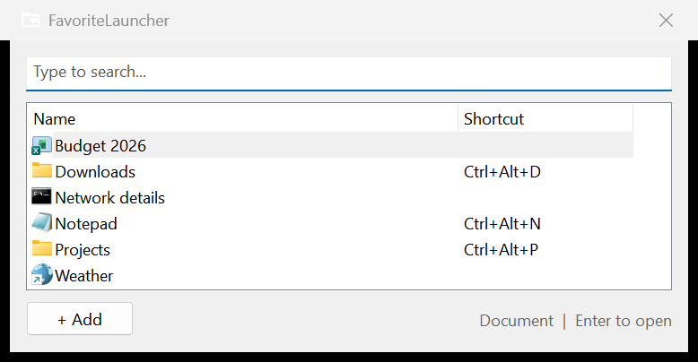
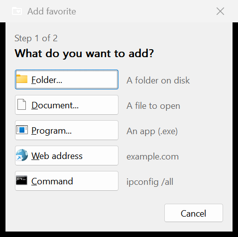
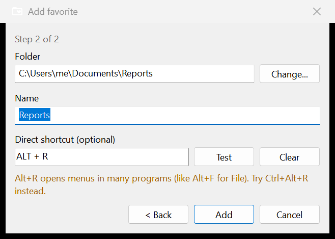
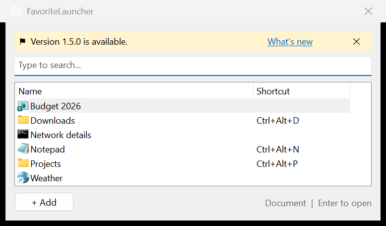

# FavoriteLauncher

Open your favorite folders, documents, programs, websites and commands from anywhere in Windows, without digging through menus.

Press **Ctrl+Alt+Space**, type a few letters, press **Enter**.



## Features

- **Type to find.** The list filters as you type. Names that start with what you typed come first.
- **Five kinds of favorites:** folders, documents, programs, web addresses and commands (for example `ipconfig /all`).
- **Direct shortcuts.** Give a favorite its own key combination, such as Ctrl+Alt+D, to open it without the launcher.
- **Works in Open/Save dialogs.** When a file dialog is open, a folder favorite takes the dialog to that folder instead of opening Explorer.
- **Start with Windows** (optional), from the tray menu.
- **Update notice.** When a newer version is released, a banner tells you, with a link to what's new.

## Install

You need Windows 10 or 11.

**Script version:** install [AutoHotkey v2](https://www.autohotkey.com/), download this repository, and double-click `FavoriteLauncher.ahk`.

**Exe version:** download `FavoriteLauncher.exe` from the [latest release](https://github.com/kennethaar/FavoriteLauncher/releases/latest), or build it yourself (see [Building](#building)). It does not need AutoHotkey installed.

Run either the script or the exe, not both: they use the same shortcut.

The first time it starts, a welcome window shows how to open the launcher. **Start with Windows** is checked, so the launcher is there after you restart. You can change this later in the tray menu.

## Use it

| Key | What it does |
| --- | --- |
| Ctrl+Alt+Space | Open the launcher |
| Type | Find a favorite |
| Up / Down | Move through the list |
| Enter | Open the selected favorite |
| F2 | Edit the selected favorite |
| Delete | Remove the selected favorite |
| Esc | Hide the launcher |

You can also right-click a favorite for Open, Edit and Remove.

The tray icon: a single click opens the launcher. Right-click for **Start with Windows**, **What's new**, **About** and **Exit**.

## Add a favorite

Click **+ Add** in the launcher.

**Step 1:** choose what to add. Folder, Document and Program open a picker right away. For a web address or a command, you type it in step 2.



**Step 2:** check the name (it is filled in for you) and, if you want, set a direct shortcut. Click **Test** to see whether the shortcut is likely to clash with something else.



### Choosing a good shortcut

**Test** warns you when a shortcut:

- is already used by another favorite, or by another running program
- is a common shortcut, such as Ctrl+S (Save) or Alt+F4
- is Alt plus a letter, which opens menus in many programs
- is a single key or Shift plus a letter, which you need for typing
- types a character on your keyboard. On many European keyboards, Ctrl+Alt is the same as AltGr, so Ctrl+Alt+2 may type `@`.

You can still use a shortcut after a warning. Ctrl+Alt plus a letter usually works well.

### Commands

A command runs in a Command Prompt window. Leave **Keep window open to show output** checked for commands whose output you want to read, such as `ipconfig /all` or `git status`. Uncheck it to run the command without a window.

## Updates

Each time FavoriteLauncher starts, it checks GitHub for a newer release. If there is one, a banner appears above the search box. **What's new** opens the release notes. ✕ hides the banner until the next version.



## Your data

Favorites are stored in `FavoriteLauncher.ini` next to the script or exe. It is a plain text file, and nothing is sent anywhere. The update check only asks GitHub for the latest version number.

## Building

From the repository folder:

```
"C:\Program Files\AutoHotkey\v2\AutoHotkey64.exe" /ErrorStdOut build.ahk
```

Or double-click `build.ahk`. It runs the test suite and, only if all tests pass, compiles `FavoriteLauncher.exe` with Ahk2Exe. You need the AutoHotkey compiler, which you can install from the AutoHotkey Dash.

To run only the tests:

```
"C:\Program Files\AutoHotkey\v2\AutoHotkey64.exe" /ErrorStdOut tests\FavoriteLauncher.Tests.ahk
```

The tests use a temporary settings file and never touch your favorites. They briefly show the app's windows, so don't type while they run.

## Changes

See [CHANGELOG.md](CHANGELOG.md).
